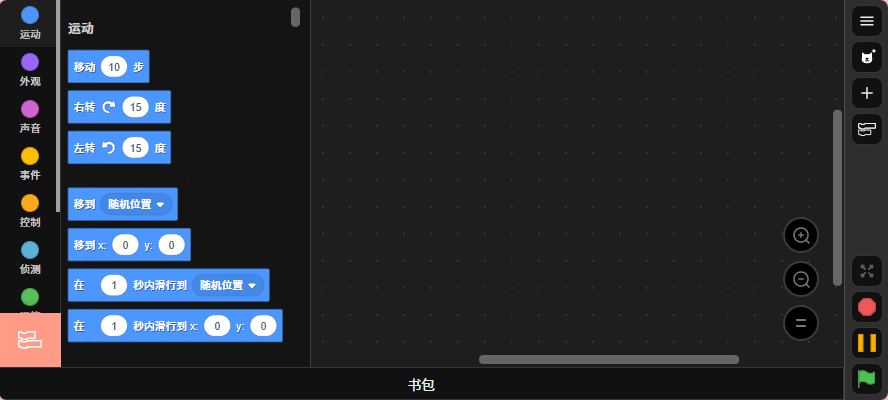
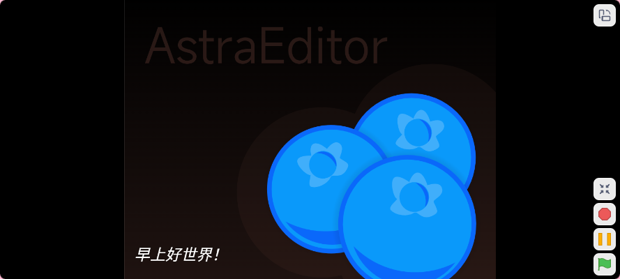
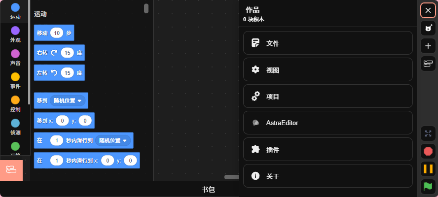

<p align="center">
  
</p>

# AstraEditor Mobile-CE

<p>
  
  
  
  
  
  
  
  
  
</p>

The mobile branch of AstraEditor, with the editor relaid out for landscape phones.



- The workspace fills the screen; the toolbar runs down the right side.
- Stage, costumes, sounds, code and settings are separate pages.
- The fullscreen stage can switch between landscape and portrait framing.





## Development

Requires Node.js >= 18 and pnpm 11.17.

```bash
pnpm install
pnpm fetch     # generates gitignored files such as the microbit hex
pnpm start     # http://localhost:1145, reachable from phones on the same LAN
```

After editing a package under `packages/`, rebuild it (the GUI uses each package's `dist`), e.g. `pnpm build:vm`.

Full build, in dependency order:

```bash
pnpm build:l10n && pnpm build:audio && pnpm build:blocks && pnpm build:render && pnpm build:vm && pnpm build:paint && pnpm build:gui
```

Two things can go wrong: `--colors` was removed in webpack-cli 6, and skipping `pnpm fetch` leaves `microbit-hex-url.cjs` missing.

## Layout

```
packages/
├── scratch-gui/     editor UI, mobile code in src/components/ae-mobile/
├── scratch-vm/      virtual machine
├── scratch-blocks/  block editor
├── scratch-render/  WebGL renderer
├── scratch-paint/   paint editor
├── scratch-audio/   audio engine
└── scratch-l10n/    translations
docs/                layout design, touch checklist, addon index
```

## Docs

- [Mobile layout design](docs/ae-mobile-layout.md)
- [Touch adaptation checklist](docs/ae-mobile-refactor-checklist.md)
- [Addon index](docs/addons.md)

## License

`scratch-gui` is GPL-3.0; see each package for the rest. Scratch is a trademark of MIT; this project is not affiliated with MIT.
