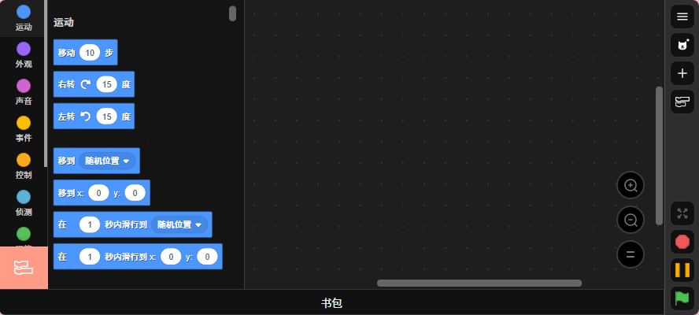
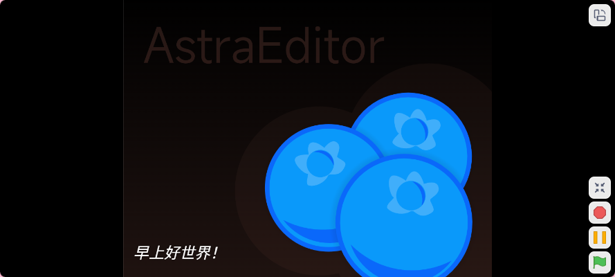
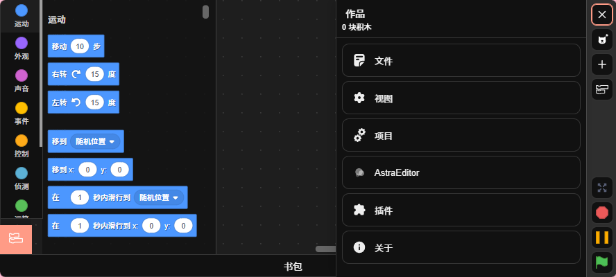

<p align="center">
  
</p>

# AstraEditor Mobile-CE

<p>
  
  
  
  
  
  
  
  
  
</p>

AstraEditor 的移动端分支，界面按手机横屏重新排布。



- 编辑区占满屏幕，工具栏竖排在右侧。
- 舞台、造型、声音、代码和设置各是一页。
- 全屏舞台可以切换横屏和竖屏构图。





## 开发

需要 Node.js >= 18 和 pnpm 11.17。

```bash
pnpm install
pnpm fetch     # 生成被 gitignore 的 microbit hex 等文件
pnpm start     # http://localhost:1145，同局域网手机可访问
```

修改 `packages/` 下的包后需要单独构建（GUI 使用各包的 `dist`），例如 `pnpm build:vm`。

完整构建按依赖顺序执行：

```bash
pnpm build:l10n && pnpm build:audio && pnpm build:blocks && pnpm build:render && pnpm build:vm && pnpm build:paint && pnpm build:gui
```

构建时可能遇到两个问题：`--colors` 参数 webpack-cli 6 已移除；未执行 `pnpm fetch` 会缺少 `microbit-hex-url.cjs`。

## 目录

```
packages/
├── scratch-gui/     主界面，移动端代码在 src/components/ae-mobile/
├── scratch-vm/      虚拟机
├── scratch-blocks/  积木编辑器
├── scratch-render/  WebGL 渲染
├── scratch-paint/   造型编辑器
├── scratch-audio/   音频
└── scratch-l10n/    翻译
docs/                布局设计、适配清单、插件目录
```

## 文档

- [移动布局设计](docs/ae-mobile-layout.md)
- [触屏适配清单](docs/ae-mobile-refactor-checklist.md)
- [插件目录](docs/addons.md)

## 许可

`scratch-gui` 为 GPL-3.0，其余见各包目录。Scratch 是 MIT 的商标，本项目与 MIT 无关。
