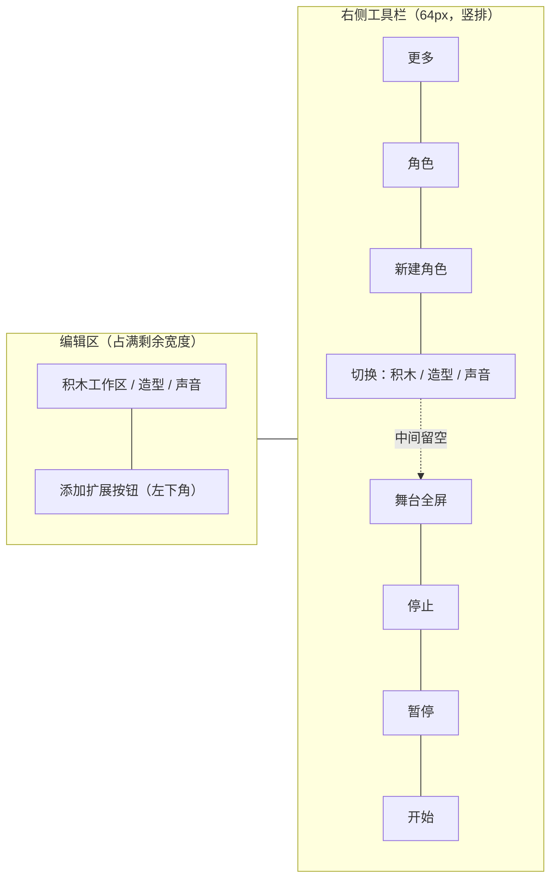

# AstraEditor Mobile — 横屏编辑器布局设计

> 目标：把 Scratch GUI 改造成面向移动设备的横屏编辑器（参考编程猫 Kitten）。
> 编辑器界面只保留「左侧编辑区 + 右侧工具栏」，舞台 / 造型 / 声音 / 更多 全部独立成页。

## 1. 布局总览

- 工具栏固定宽 64px，贴在右侧，竖排。
- 顶部组（自上而下）：更多 → 角色 → 新建角色 → 积木/造型/声音切换。
- 中间留空，不摆放任何控件。
- 底部组：舞台全屏 → 停止 → 暂停 → 开始。
- 强制横屏：竖屏时盖一层「请旋转设备」提示，并尝试 `screen.orientation.lock('landscape')`。

## 2. 右侧工具栏

| 按钮 | 行为 |
| --- | --- |
| 更多 | 打开「更多」面板（见第 4 节） |
| 角色 | 打开角色属性面板（见第 3 节） |
| 新建角色 | 打开素材库（复用 `openSpriteLibrary`） |
| 切换 | 弹出悬浮层，三项：积木 / 造型 / 声音，当前项高亮 |
| 舞台全屏 | 切到 Scratch 原生全屏状态：编辑器整体隐藏，舞台铺满视口，工具栏悬浮其上，四键位置不变 |
| 停止 | `vm.stopAll()` |
| 暂停 | `vm.togglePause()`，暂停中图标变「播放」并高亮 |
| 开始 | `vm.start()` + `vm.greenFlag()` |

## 3. 角色属性面板

点「角色」从右侧滑出，覆盖工作区：

1. 角色网格：一排 4 个（`$sprites-per-row`），向下排列，缩略图 + 名字。
2. 属性区（网格下方）：
   - X 坐标 / Y 坐标
   - 大小 / 方向
   - 显示开关 / 旋转方式（自由旋转、左右翻转、不旋转）
3. 面板底部单独一块「背景」：分隔线 + 不同底色，与角色明确区分，显示当前背景缩略图，点击可进背景管理。
4. 点缩略图 = 切换当前角色并收起面板。
5. 长按 / 右键缩略图 = 原版菜单（复制 / 导出 / 删除）；造型、声音入口在右侧工具栏的切换按钮。

## 4. 更多面板

侧滑面板，顶部固定：

- 项目名称（点击可改名，复用 `ProjectTitleInput` 或直接展示）
- 积木总数（复用 `block-count` 插件的算法：各角色 `_blocks` 中非 shadow 块求和）

下面四条，进入二级页：

| 条目 | 二级页内容 |
| --- | --- |
| 文件 | 复用 `MenuBar`（文件/编辑/工具 下拉），保证保存、导出等行为与桌面完全一致 |
| 视口 | 语言、显示模式（界面主题）、积木主题、主题色 —— 直接复用 `LanguageMenu`、`TWGuiThemeMenu`、`TWBlocksThemeMenu`、`TWAccentThemeMenu` |
| 插件 | 调用 `onClickAddonSettings`（TurboWarp Addons 列表） |
| 设置 | 调用 `onClickSettingsModal`（高级设置） |

已移除的入口：README、Monaco 编辑器、教程。

## 5. 编辑区

- 积木页：`<Blocks>` 常驻，不再有 Tab 栏。
- 左下角保留 Scratch 原样「添加扩展」按钮（`$looks-secondary` 竖条）。
- 造型页 / 声音页：复用 `CostumeTab`、`SoundTab`，外面套一层带返回按钮的页面容器。
- 舞台页：复用 `StageWrapper`（full 档）。

## 6. 状态

| 状态 | 来源 |
| --- | --- |
| 当前编辑页（积木/造型/声音） | 复用 `reducers/editor-tab` 的 `activeTabIndex` |
| 舞台全屏 | gui 内局部 state |
| 角色面板开关 | gui 内局部 state |
| 更多面板开关 / 二级页 | gui 内局部 state |
| 暂停状态 | `vm.runtime.paused`（VM 层新增） |

## 7. 代码改动清单

新增 `packages/scratch-gui/src/components/ae-mobile/`：

- `icons.jsx` — 内联 SVG 图标
- `mobile-toolbar.jsx` / `.css` — 右栏 + 切换悬浮层
- `mobile-sprite-panel.jsx` / `.css` — 角色属性面板
- `mobile-more-panel.jsx` / `.css` — 更多面板与二级页
- `mobile-screen.jsx` / `.css` — 全屏页面容器（带返回条）

新增 `packages/scratch-gui/src/lib/project-stats.js` — 积木计数。

修改：

- `components/gui/gui.jsx` — 去掉双栏 + Tab 布局，改为横屏结构
- `components/gui/gui.css` — 工作区样式、竖屏提示层
- `css/units.css` — `$ae-toolbar-width`、`$ae-screen-header-height`
- `playground/index.ejs` — viewport meta（禁缩放、适配刘海屏）
- `packages/scratch-vm/src/engine/runtime.js` — `paused` 标志、`setPaused` / `togglePause`
- `packages/scratch-vm/src/virtual-machine.js` — `pause` / `resume` / `togglePause` / `isPaused`

## 8. 待真机验证

- 触屏上 `MenuLabel` 的下拉是否可点开（文件二级页依赖它）
- 软键盘弹出时工作区是否被遮挡
- 长按 500ms 与积木拖拽是否冲突
- 横屏锁定在各浏览器（Safari / Chrome Android / WebView）的实际表现

## 9. 实现状态

已完成：

- VM 层暂停：`runtime.paused` + `setPaused/togglePause` + `_step` 提前返回，`greenFlag/stopAll` 自动解除暂停；
  `virtual-machine.js` 暴露 `pause/resume/togglePause/isPaused`
- `components/ae-mobile/`：`icons.jsx`、`mobile-toolbar.jsx/.css`、`mobile-sprite-panel.jsx/.css`、
  `mobile-more-panel.jsx/.css`、`mobile-screen.jsx/.css`
- `lib/project-stats.js`：沿用 block-count 插件算法统计非影子块
- `gui.jsx` 重写布局：横屏「编辑区 + 右栏」，舞台/造型/声音独立页，角色面板，更多面板，竖屏提示层
- 编辑区在切到造型/声音页时**只隐藏不卸载**（`.is-hidden`），避免 Blockly 工作区反复重建
- `playground/index.ejs`：viewport 禁缩放 + `viewport-fit=cover`
- `css/units.css`：`$ae-toolbar-width: 64px`、`$ae-screen-header-height`

## 10. 构建 / 检查记录（2026-11-15）

仓库级 `pnpm build` 在当前依赖版本下**跑不通**，与本次改动无关，原因有两个：

1. `scratch-render` / `scratch-vm` 的 build 脚本仍带 `--colors`，webpack-cli 6 已移除该参数 →
   `Error: Unknown option '--colors'`。绕过方式：进包目录直接 `NODE_ENV=production npx webpack`。
2. `scratch-gui` 依赖 `src/generated/microbit-hex-url.cjs`，该文件被 `.gitignore` 忽略，
   需先执行 `node packages/scratch-gui/scripts/prepublish.mjs`（或根目录 `pnpm fetch`）生成。
   这就是「文件缺失」的报错来源。

实际验证结果：

- `eslint --ext .js,.jsx` 覆盖全部改动文件：**0 error**；剩余 warning 为 `canShowReadme`、`intl`、
  `customStageSize`、`TWWindChimeSubmitter` 等已不再使用的旧变量（不影响运行）
- `scratch-render` / `scratch-vm` 库构建成功（vm 的 playground bundle 因 `@turbowarp/scratch-svg-renderer/dist/web`
  缺失而报错，属既有环境问题，不影响库产物）
- `scratch-gui` `NODE_ENV=production npx webpack --bail`：**exit 0**，仅剩 bundle 体积警告

## 11. 已知待打磨

- 「文件」二级页现在是直接复用 `MenuBar`，在 360px 面板内会挤成一横排，且下拉菜单会被面板裁切。
  需要把文件菜单拆成纵向列表（或给 MenuBar 加一个纵向模式）。
- 项目名称目前只做展示，改名仍需桌面式输入控件
- 删除角色未接撤销（`restore-deletion`），且删到只剩一个角色时会静默失败
- 长按菜单出现在手指正下方，靠边时可能超出屏幕

## 12. 第二轮重写（引用原版实现）

针对「汉化缺失 / 角色面板不像 Scratch / 工具栏没迁移 / 全屏舞台不是真全屏」四个问题，
这一轮把自造的部分尽量换成 Scratch 原版组件和文案。

### 12.1 汉化

新增 `src/lib/ae-translations.js`，在 `reducers/locales.js` 里和 TurboWarp 的附加翻译一起
合并进 `editorMessages`（`addAeTranslations`）。只放 Scratch 词库里没有的词：

| id | 中文 |
| --- | --- |
| `ae.mobile.more` | 更多 |
| `ae.mobile.viewport` | 视口 |
| `ae.mobile.pause` / `ae.mobile.resume` | 暂停 / 继续 |
| `ae.mobile.blockCount` | {num} 块积木 |
| `ae.mobile.close` | 关闭 |

其余全部换成原版 id，直接吃 `@turbowarp/scratch-l10n` 自带的中文：

- 运行 `gui.controls.go`、停止 `gui.controls.stop`
- 全屏舞台 `gui.stageHeader.stageSizeFull`（进入全屏模式）
- 角色 `gui.SpriteInfo.sprite`、新建 `gui.spriteSelector.addSpriteFromLibrary`
- 代码/造型/声音 `gui.gui.codeTab` / `gui.gui.costumesTab` / `gui.gui.soundsTab`
- 文件 `gui.menuBar.file`、插件 `tw.menuBar.addons`、设置 `gui.menuBar.settings`

### 12.2 角色面板

不再自己画属性控件，改为直接挂 `containers/target-pane.jsx`（`TargetPane`），
里面就是原版 `SpriteInfo` + `SpriteList` + `ActionMenu` + `StageSelector`。

只调整堆叠顺序与尺寸：

- `components/sprite-selector/sprite-selector.jsx`：`SpriteList` 移到 `SpriteInfo` 之前
- `components/sprite-selector/sprite-selector.css`：改为 flex column，列表 `flex:1` 滚动，
  底部留 `3.25rem` 给原版「添加角色」浮动按钮
- `components/target-pane/target-pane.css`：改为纵向，背景选择器压到底部并旋转成横条
  （用 `[class*='stage-selector_*']` 属性选择器覆盖，不复制原版样式）
- `css/units.css`：`$sprites-per-row` 5 → 4（一排 4 个）
- `components/target-pane/target-pane.jsx`：加 `hideSpriteLibrary`，避免面板内再渲染一份素材库

原版 `SpriteSelectorItem` 自带右键菜单（复制 / 导出 / 删除），长按触发的就是它；
造型 / 声音入口走右侧工具栏的切换按钮。

### 12.3 工具栏

图标全部换成原版资源：`action-menu/icon--sprite.svg`、`gui/icon--code|costumes|sounds.svg`、
`stage-header/icon--fullscreen.svg`、`stop-all/icon--stop-all.svg`、`green-flag/icon--green-flag.svg`。
只有「更多」「新建」「暂停」三个图标仍是内联 SVG（Scratch 没有对应资源）。
宽度 64px，按钮 36px，矮屏仍有余量。

### 12.4 全屏舞台

不再用局部 state，而是走 Scratch 自己的全屏状态：

- 工具栏按钮 → `dispatch(setFullScreen(!isFullScreen))`（`reducers/mode`）
- `gui.jsx` 在 `isFullScreen` 时只渲染 `<StageWrapper hideStageHeader isFullScreen stageSize="full" />`，
  整个编辑器（工作区 / 角色面板 / 更多面板）都不渲染
- `StageWrapper` 新增 `hideStageHeader`，全屏时不渲染桌面舞台头（大小切换 + 绿旗/停止）
- `gui.css` 的 `.mobile-full-stage` 把 `.stage-wrapper.full-screen` 强制拉成 `inset: 0`，
  去掉桌面端为菜单栏预留的顶部偏移
- 工具栏加 `.is-overlay`：全屏时 `position: fixed` 悬浮在舞台之上，四个运行键位置不变

### 12.5 更多面板

「文件」页仍是原版 `MenuBar`，但用 `gui.css` 里的属性选择器把它改造成纵向手风琴：
`.file-page-menu-bar [class*='menu-bar_menu-bar-menu']` 改成 `position: static` 内联展开，
菜单项整行 44px，并隐藏账户 / 分享 / 反馈块。

### 12.6 验证

- `eslint`：0 error（gui.jsx 仍剩若干"未使用 props"的 warning，用于阻止 props 泄漏到 DOM）
- `scratch-gui` 生产构建：`NODE_ENV=production npx webpack --bail` → exit 0，仅体积警告
